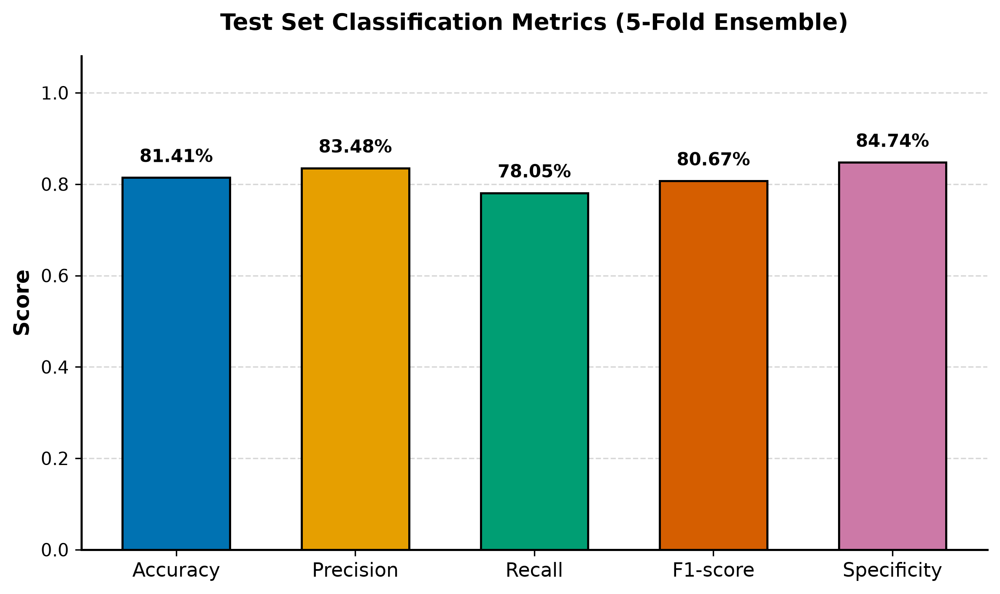

# EEG BCI Transformer Pipeline

**EEG BCI Transformer Pipeline** is an end-to-end deep learning framework written in Python, built on [PyTorch](https://pytorch.org/) and [MNE-Python](https://mne.tools/), specifically designed for **binary Motor Imagery (MI) EEG classification (left hand vs. right hand)** in Brain-Computer Interface (BCI) applications.

The entire workflow, from EEG preprocessing and epoch extraction to model training and evaluation, is tailored for binary MI decoding. Within this shared binary pipeline, the project reproduces the **F_CTrans** architecture proposed by *Jin Xie et al. ("A Transformer-Based Approach Combining Deep Learning Network and Spatial-Temporal Information for Raw EEG Classification", IEEE TNSRE, 2022)* alongside a **modified architectural variant** (`F_CTrans_modified`).

---

## Dataset

The project uses the **[PhysioNet EEG Motor Movement/Imagery Dataset](https://doi.org/10.13026/C28G6P)** (Schalk, 2009):
- 109 subjects (Motor Imagery runs: `4, 8, and 12`)
- 64-channel EEG recordings
- Motor Imagery tasks (imagined left- vs. right-hand movement)
- Binary classification: Left Hand (`T1`) vs. Right Hand (`T2`)
- Sampling frequency: `160 Hz` (uniformly resampled)
- Data duration: Cue-locked epochs extracted from `tmin` to `tmax` (`4s` windows)

> **Dataset Citation:** Schalk, G. (2009). *EEG Motor Movement/Imagery Dataset* (version 1.0.0). PhysioNet. RRID:SCR_007345. [https://doi.org/10.13026/C28G6P](https://doi.org/10.13026/C28G6P)

---
## Architectures at a Glance

Both models process raw EEG epochs through parallel spatial and temporal Transformer streams, differing in feature pooling, normalization, and classification head design:

| Component | `F_CTrans` (Baseline — Xie et al., 2022) | `F_CTrans_modified` (Custom Variant) |
| :--- | :--- | :--- |
| **Feature Extraction** | Parallel Spatial & Temporal Conv + Transformer Encoders | Parallel Spatial & Temporal Conv + Transformer Encoders |
| **Stream Pooling** | Global Average Pooling (`Mean`) | Dual Global Pooling (`Mean + Max` concatenated) |
| **Pre-Fusion Normalization** | None | Independent `LayerNorm` on spatial and temporal features |
| **Classification Head** | Single Linear Layer | Multi-Layer Perceptron (`Linear -> ReLU -> Dropout -> Linear`) |

---

## Project Structure

```text
eeg-bci-transformer-pipeline/
├── .github/                                # GitHub Actions CI workflows
├── docs/                                   # Sphinx documentation source files
├── notebook/                               # Final notebooks with definitive results & evaluations
│   └── train_val_F_CTrans/                 # Saved model weights and training checkpoints
├── roadtrip/                               # Exploratory notebooks documenting design iterations
│   └── saved_models/                       # Saved model weights and training checkpoints
├── src/
│   └── eeg_bci_transformer_pipeline/
│       ├── __init__.py
│       ├── datapreprocessing.py            # MNE preprocessing pipeline & PyTorch EEGDataset
│       ├── models.py                       # F_CTrans baseline & F_CTrans_modified architectures
│       └── train.py                        # EEGTrainer loop, validation & EarlyStopper
├── tests/                                  # Unit tests
├── config.yaml                             # Experiment & model hyperparameters configuration
├── noxfile.py                              # Automated linting (Ruff, Pylint), tests & docs sessions
├── pyproject.toml                          # Package metadata & build configuration
├── requirements.txt                        # Python dependencies
└── README.md
```

---

## Installation

1. **Clone the repository and navigate into the project directory:**

```bash
git clone [https://github.com/mariasonetto01/eeg-bci-transformer-pipeline.git](https://github.com/mariasonetto01/eeg-bci-transformer-pipeline.git)
cd eeg-bci-transformer-pipeline
```

2. **Create and activate a virtual environment (recommended):**

```bash
python -m venv venv
source venv/bin/activate      
```
3. **Install the package in editable mode:**

```bash
pip install -e .
```
---

## Testing

This project uses [Nox](https://nox.thea.codes/) to automate code quality checks, testing, and documentation builds.

Run all checks (Ruff, Pylint, and Sphinx documentation) with:

```bash
nox -s ruff pylint docs
```

---
## Documentation

Full API references, architectural details, and usage guides are built with [Sphinx](https://www.sphinx-doc.org/) and hosted online:

- **Online Documentation:** [mariasonetto01.github.io/eeg-bci-transformer-pipeline](https://mariasonetto01.github.io/eeg-bci-transformer-pipeline/)

---
## Experimental Workflow Overview

First, raw EEG recordings are processed through the `EEGpreprocessing` module applying band-pass filtering in the sensorimotor rhythms (:math:`\mu` and :math:`\beta` bands), epoch extraction around cue annotations (``T1``, ``T2``) and partitioned via a **5-Fold `GroupKFold`** strategy grouped by subject ID. 
This subject-independent split prevents data leakage, ensuring that z-score normalization statistics (`train_mean`, `train_std`) are computed exclusively on each training fold and applied strictly to unseen validation and test subjects.

The modeling phase evaluates two dual-stream CNN-Transformer variants: the baseline `F_CTrans` architecture (Jin Xie et al., 2022), trained under its original fixed learning rate schedule (`MultiStepLR`) to establish a reference benchmark, and an enhanced version (`F_CTrans_modified`).

Upon comparing both architectures and selecting the superior model, the workflow transitions to hyperparameter optimization.To identify an optimal regularization regime, a systematic Grid Search over learning rate, weight decay, and dropout is conducted across two splits (Folds 1 and 4), prioritizing a balanced trade-off between validation accuracy and loss stability.

Finally, using the optimal hyperparameter configuration, the selected model is trained across all **5 `GroupKFold` splits** via `EEGTrainer`, checkpointing the best-performing weights alongside the fold-specific normalization statistics. Generalization performance is ultimately assessed on the held-out test set through a **5-Fold Probability Ensemble**, averaging softmax predictions across all five models to reduce variance and produce robust final classifications.

---
## Experimental Results

### Final Model Configuration

The table below summarizes the architectural parameters and optimal hyperparameters selected via cross-validated grid search for the final 5-fold ensemble training:

| Category | Parameter | Value |
| :--- | :--- | :--- |
| **Architecture** | Selected Model | `F_CTrans` |
| | Input Channels (`num_channels`) | `64` |
| | Embedding Dimension (`d_model`) | `128` |
| | Attention Heads (`nhead`) | `8` |
| | Feed-Forward Dimension (`d_ff`) | `512` |
| | Transformer Layers (`num_layers`) | `3` |
| **Optimization** | Optimizer | `Adam`  |
| | Initial Learning Rate (`lr`) | `0.001` |
| | Weight Decay | `0.001 ` |
| | Dropout Rate | `0.3` |
| | Scheduler | `MultiStepLR` (`milestones=[10, 30]`, `gamma=0.1`) |
| | Batch Size / Epochs | `64` / `50` |
| **Evaluation** | Cross-Validation Strategy | 5-Fold `GroupKFold` (Subject-Independent) |
| | Inference Method | 5-Fold Softmax Probability Ensemble |

---

### Test Set Performance

